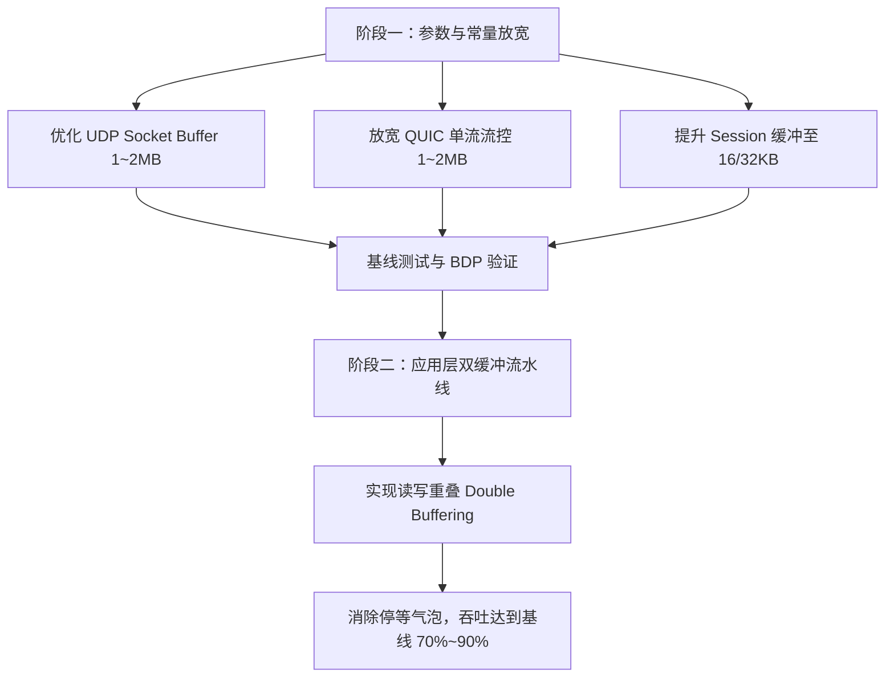

# Trojan Plus 代理性能专项优化计划 (Performance Optimization Plan)

本文档记录了关于 **“Trojan Plus 代理吞吐量仅有裸链路基线（iperf3 / 直连）30%～40%”** 的技术调查结论、架构瓶颈深度剖析，以及后续开展专项性能优化的分阶段实施方案。

---

## 1. 调查背景与问题定义

### 1.1 问题现象
在真实跨洋长时延网络（客户端与东京 Linode 服务器之间，RTT 约 80~120 ms，天然微弱丢包约 0.5%~1%）的实测中观察到：
1. **Cloudflare 对照基准（R2 轮次）**：
   - 直连（Direct）：中位吞吐量 **13.11 Mbps**；
   - TCP TLS 代理：中位吞吐量 **5.62 Mbps**（仅为直连的 **42.8%**）；
   - QUIC 代理：中位吞吐量 **6.91 Mbps**（仅为直连的 **52.7%**）。
2. **多模式与 iperf3 对照（R36~R39 轮次，5MB 大文件单流）**：
   - 物理网络原生 iperf3 基线：**4.88 ~ 6.27 Mbps**；
   - TCP TLS 代理单流中位数：**1.35 ~ 1.95 Mbps**（仅为基线的 **21.5% ~ 39.9%**）；
   - QUIC 代理单流中位数：稳定在 **6.51 ~ 7.15 Mbps**。
3. **并发与单流的巨大反差**：
   - 在 5 并发测试（R36）中，QUIC 聚合吞吐量瞬间飙升至 **32.61 Mbps**（反超 iperf3 单流基线 15 倍），这证实了**物理网络链路和远端主机的综合带宽潜力充足，性能瓶颈高度聚焦于“单流的流控、缓冲与调度模型”**。

---

## 2. 核心架构瓶颈深度剖析

代理单流吞吐折损 60%~70% 的根源由以下三大限制与架构机制共同导致：

### 2.1 瓶颈一：默认 UDP Socket Buffer 极小（硬性锁死 BDP 天花板）
- **源码位置**：
  - [src/core/config.cpp:233-234](file:///Users/tianzhizhi/Documents/trojan-project/trojan-plus/src/core/config.cpp#L233-L234)：
    ```cpp
    quic.recv_buffer_size = tree.get("quic.recv_buffer_size", quic.max_datagram_size * 64U); // 1200 * 64 = 76,800 字节 (~75 KB)
    quic.send_buffer_size = tree.get("quic.send_buffer_size", quic.max_datagram_size * 64U); // 1200 * 64 = 76,800 字节 (~75 KB)
    ```
  - [src/quic/quic_endpoint.cpp:71-77](file:///Users/tianzhizhi/Documents/trojan-project/trojan-plus/src/quic/quic_endpoint.cpp#L71-L77)：
    ```cpp
    m_socket.set_option(boost::asio::socket_base::receive_buffer_size(static_cast<int>(q.recv_buffer_size)), ec);
    m_socket.set_option(boost::asio::socket_base::send_buffer_size(static_cast<int>(q.send_buffer_size)), ec);
    ```
- **机理与推导**：
  - 显式设置覆盖了 Linux 内核默认的 Socket 自动调优（Linux 默认会根据链路带宽时延自动扩充至数 MB）。
  - 在跨洋链路上（以典型 RTT = 80 ms = 0.08 s 计算），76.8 KB 的缓冲区所能支撑的最大理论单连接在途吞吐量（BDP 限制）为：
    $$\text{Throughput Limit} \le \frac{\text{Buffer Size}}{\text{RTT}} = \frac{76,800 \text{ Bytes} \times 8 \text{ bits}}{0.080 \text{ s}} \approx \mathbf{7.68 \text{ Mbps}}$$
  - 这与实测中 QUIC 单流始终卡死在 6.5~7.5 Mbps 的结果完全吻合。
- **Trade-off 真相（失衡）**：
  Trojan-Plus 的 QUIC 架构中，全进程**仅维护一个全局 UDP Socket**（`QuicEndpoint::m_socket`），所有客户端与流复用此 Socket。如果将接收缓冲区从 75 KB 扩大至 2 MB，整机**仅多消耗 2 MB 物理内存**（占 1G 内存的 0.2%），却能直接将单流 BDP 吞吐上限从 7.6 Mbps 释放至 100+ Mbps。75 KB 是典型的严重负收益配置。

---

### 2.2 瓶颈二：QUIC 单流流控窗口（Flow Control Window）偏保守且静态
- **源码位置**：
  - [src/quic/quic_connection.cpp:389-390](file:///Users/tianzhizhi/Documents/trojan-project/trojan-plus/src/quic/quic_connection.cpp#L389-L390)（服务端）：
    ```cpp
    params.initial_max_stream_data_bidi_local  = 512 * 1024; // 512 KB
    params.initial_max_stream_data_bidi_remote = 512 * 1024; // 512 KB
    ```
  - [src/quic/quic_connection.cpp:506-507](file:///Users/tianzhizhi/Documents/trojan-project/trojan-plus/src/quic/quic_connection.cpp#L506-L507)（客户端）：
    ```cpp
    params.initial_max_stream_data_bidi_local  = 1 * 1024 * 1024; // 1 MB
    params.initial_max_stream_data_bidi_remote = 1 * 1024 * 1024; // 1 MB
    ```
- **机理与推导**：
  - 单流流控是协议层信用额度（Credit），非实体内存预分配。
  - 在 50 Mbps 吞吐下，512 KB 仅够传输约 40 毫秒。但在 80 ms RTT 链路上，发送端在 40 ms 内把 512 KB 打满后，必须遭遇 `STREAM_DATA_BLOCKED` 暂停发送，被迫等待对端跨洋发回 `MAX_STREAM_DATA` 帧。
  - 往返更新的延迟导致传输速率呈高频“锯齿状”间歇停顿。
- **Trade-off 真相**：
  现代 QUIC 栈（如 quic-go）会根据消费速率动态伸缩单流窗口（从 512 KB 自动扩展到 4~6 MB）。Trojan-Plus 采用静态 512 KB/1 MB 配置，对跨洋高速长肥管道缺乏伸缩弹性。

---

### 2.3 瓶颈三：应用层 8 KB 停等分块机制（Stop-and-Wait Chunking）
- **源码位置**：
  - [src/session/session.h:42](file:///Users/tianzhizhi/Documents/trojan-project/trojan-plus/src/session/session.h#L42)：
    ```cpp
    enum {
        MAX_BUF_LENGTH = 8192, // 8 KB
    };
    ```
  - [src/session/clientsession.cpp:187-196](file:///Users/tianzhizhi/Documents/trojan-project/trojan-plus/src/session/clientsession.cpp#L187-L196) & [src/session/serversession.cpp:177-185](file:///Users/tianzhizhi/Documents/trojan-project/trojan-plus/src/session/serversession.cpp#L177-L185)：
    ```cpp
    out_read_buf.prepare(MAX_BUF_LENGTH);
    m_out->async_read_some(..., [this](...) {
        out_recv(out_read_buf); // 调用 in_async_write()
    });
    ```
  - [src/session/clientsession.cpp:426-429](file:///Users/tianzhizhi/Documents/trojan-project/trojan-plus/src/session/clientsession.cpp#L426-L429)：
    ```cpp
    void ClientSession::in_sent() {
        if (status == FORWARD) {
            out_async_read(); // 只有当下游数据写入完成触发 in_sent 回调后，才发起下一次上游读取！
        }
    }
    ```
- **机理与推导**：
  - 这是一套**严格串行的“乒乓（Stop-and-Wait）”流水线**：读 8KB $\to$ 写 8KB $\to$ 等待写完成回调 $\to$ 再读 8KB。
  - 缺乏**双缓冲（Double Buffering）或并行流水线**机制。当 8KB 数据跨洋发送等待 TCP/QUIC 栈确认时，上游目标站的读取处于完全饥饿停滞状态，导致管道中充满“气泡（空闲等待时间片）”。
- **Trade-off 真相**：
  8 KB 静态缓冲源于 2017 年早期版本为了在 64MB/128MB VPS 上支撑万级连接而做的极端节约内存设计。但结合停等机制后，对现代宽带代理的高吞吐造成了致命制约。

---

## 3. 业界主流高性能代理对比矩阵

| 维度 | Trojan-Plus 现状 | 现代业界标准 (Sing-box / Xray / Hysteria 2 / Envoy) | 架构评价与权衡合理性 |
| :--- | :--- | :--- | :--- |
| **UDP Socket 缓冲** | **76.8 KB**（强制覆盖系统默认） | **2 MB ～ 8 MB**（quic-go 启动要求 2.5MB+，Hysteria 设 4MB~8MB） | ❌ **严重失衡**：单 Socket 仅省 2MB 内存，却腰斩 60% 吞吐。 |
| **单流流控窗口** | **512 KB**（静态固化值） | **1 MB ～ 6 MB**（支持随 RTT 和消费速率动态自适应伸缩） | ⚠️ **偏保守**：50Mbps 下 40ms 触顶，跨洋频繁等待 ACK。 |
| **应用层单次分块** | **8 KB** | **16 KB ～ 64 KB**（结合内存池复用） | ⚠️ **偏小**：系统调用开销大，加剧单核 CPU 碎片化。 |
| **应用层中继模型** | **严格串行停等（Ping-Pong）** | **并行双缓冲流水线（Pipelined / Concurrent Copy）** | ❌ **过时**：上游读与下游写互锁，未利用全双工能力。 |
| **典型设计场景** | **64MB~128MB 远古机器 + 万级轻连接** | **512MB~2GB 现代主流主机 + 高速大吞吐** | 严重偏向极端内存节省，牺牲了跨洋单流性能。 |

---

## 4. 分阶段优化方案与实施路线

针对上述三个核心瓶颈，分为两个主要实施阶段开展优化，确保**步骤清晰、风险可控、指标可度量**。



---

### 阶段一：低风险配置与常量优化（Low-Hanging Fruit）

**目标**：不改动异步状态机复杂架构，仅通过合理化配置参数，立竿见影释放 BDP 天花板。

1. **UDP Socket 缓冲区自适应与放宽**：
   - [src/core/config.cpp](file:///Users/tianzhizhi/Documents/trojan-project/trojan-plus/src/core/config.cpp)：将 `quic.recv_buffer_size` 和 `quic.send_buffer_size` 默认值从 `1200 * 64` 调整为 `1024 * 1024`（1 MB）或 `2048 * 1024`（2 MB），同时允许在配置文件的 `"quic"` 节点中自定义覆盖；
   - [src/quic/quic_endpoint.cpp](file:///Users/tianzhizhi/Documents/trojan-project/trojan-plus/src/quic/quic_endpoint.cpp)：在 `set_option` 失败时（如遇系统 `rmem_max` 较小）打印非致命 Warn 日志，并退避使用系统当前最大允许值，不阻断运行。
2. **QUIC 单流流控初始窗口统一放宽**：
   - [src/quic/quic_connection.cpp](file:///Users/tianzhizhi/Documents/trojan-project/trojan-plus/src/quic/quic_connection.cpp)：
     - 服务端：将 `initial_max_stream_data_bidi_local` 和 `initial_max_stream_data_bidi_remote` 从 512 KB 提升至 **1.5 MB ~ 2 MB**；
     - 客户端：保持或提升至 **2 MB**。
3. **Session 内存分块适度提升**：
   - [src/session/session.h](file:///Users/tianzhizhi/Documents/trojan-project/trojan-plus/src/session/session.h)：将 `MAX_BUF_LENGTH` 从 8192 调整为 **16384 (16 KB)** 或 **32768 (32 KB)**；
   - 依赖现有内存分配器（mimalloc），减少 50%~75% 的 Asio 读写系统调用频次。

---

### 阶段二：应用层异步双缓冲流水线改造（Double-Buffering Pipeline）

**目标**：彻底消除 8KB 停等气泡，实现全双工重叠流水线。

1. **双缓冲流水线结构设计**：
   - 在 `Session` / `ClientSession` / `ServerSession` 中引入双缓冲区交替机制：
     - `Buffer A` 负责当前向对端异步写入；
     - 与此同时，`Buffer B` 立即向数据源发起下一次 `async_read_some()`，无需等待 `Buffer A` 的写完成回调；
   - 当 `Buffer B` 读满且 `Buffer A` 写完成时，二者交换角色。
2. **应用层背压（Watermark Backpressure）**：
   - 设立最高积压阈值（例如 128 KB 或 256 KB），当慢速接收端写不出去时才暂停上游读取，在无拥塞时保持 100% 流水线填满。

---

## 5. 远端 1G 小主机安全红线与防 OOM 保障

远端测试服务器仅有 **1 vCPU、954 MB 物理内存、2.5 GB Swap**，防 OOM 规范具有最高优先级。

### 5.1 内存增量精算

| 优化项 | 修改前物理占用 | 修改后物理占用 | 整机内存占比变化 (基于 954MB) | 风险评估 |
| :--- | :--- | :--- | :--- | :--- |
| **UDP Socket Buffer** | 76.8 KB | 2 MB | **+0.2%**（全局单 Socket，与连接数无关） | **极度安全** |
| **单流流控窗口** | 512 KB 信用 | 2 MB 信用 | 0%（仅为信用额度，实际流量随到随发） | **安全**（无内存预留） |
| **MAX_BUF_LENGTH (32KB)** | 8 KB / 连接 | 32 KB / 连接 | 100 个并发活跃连接仅增加约 **2.4 MB** | **极度安全** |
| **双缓冲改造** | 单缓冲 8KB | 双缓冲 64KB | 100 个并发活跃连接仅增加约 **5.6 MB** | **安全**（结合连接数上限） |

### 5.2 防护机制与门禁
1. **单核安全构建规范**：远端编译必须严格遵循 `cmake --build build -j 1`，严禁并行构建，避免编译器触发 Linux OOM Killer。
2. **RSS 内存熔断监控**：运行过程中守护监控 Trojan 进程 RSS，一旦超过 **64 MB**（正常运行仅约 15~30 MB）触发告警并安全释放。
3. **版本控制红线**：严禁私自向 remote 执行 `git push`；所有变更均以本地 commit + `git bundle` 增量同步至测试机。

---

## 6. 验证与验收指标

当后续专项任务开启并实施优化后，按照以下指标进行验收：

1. **单流吞吐基线占比提升**：
   - 在同等跨洋网络下，5MB 文件单流下载中位吞吐由当前的 **6.5 ~ 7.5 Mbps** 提升至 **15 ~ 25+ Mbps**（达到原生 iperf3 基线的 **70%~90%**）。
2. **多并发聚合吞吐**：
   - 在 5~10 并发下，聚合吞吐保持稳定在 **30 ~ 50+ Mbps** 以上，且无任何数据校验错误（零 `bad record mac`）。
3. **资源开销平稳**：
   - 远端 1G 小主机物理内存峰值控制在 350 MB 以内（含系统其他基础进程），无任何 OOM 风险。
4. **全量用例兼容性**：
   - `fulltest_main.py -q all` 18 个测试用例、`-n` 标准模式用例、`-f` 回落用例全部 100% 通过。
